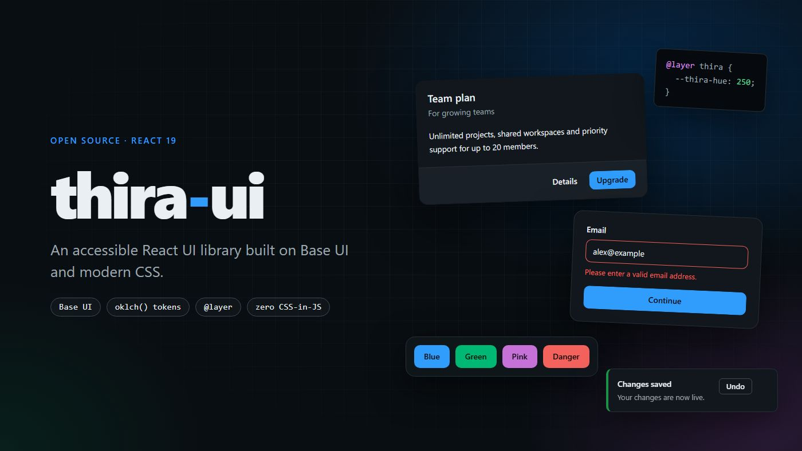

# thira-ui



[](https://www.npmjs.com/package/thira-ui)
[](https://github.com/thiraphat-ps-dev/thira-ui/actions/workflows/ci.yml)
[](./LICENSE)
[](https://thiraphat-ps-dev.github.io/thira-ui/)
[](https://thiraphat-ps-dev.medium.com/building-a-react-ui-library-with-native-css-lessons-from-thira-ui-69975f7c3607)

A minimal, accessible React component library built on [Base UI](https://base-ui.com) primitives and modern CSS.

**[▶ Live demo (Storybook)](https://thiraphat-ps-dev.github.io/thira-ui/)** · **[📖 How it was built](https://thiraphat-ps-dev.medium.com/building-a-react-ui-library-with-native-css-lessons-from-thira-ui-69975f7c3607)**

- **Accessible by default.** Focus management, keyboard support and ARIA come from Base UI; every story is checked with axe in light and dark mode.
- **Modern CSS, zero runtime.** CSS Modules, CSS variables, nesting and `oklch()` relative colors — no CSS-in-JS.
- **Easy to override.** All styles live in `@layer thira`, so your own CSS always wins without `!important`.
- **Themeable with one variable.** Change `--thira-hue` and every accent, hover and focus color follows.

> **Status:** early (v0.x). APIs may change before 1.0.

## Components

| Component     | Notes                                                                                                                     |
| ------------- | ------------------------------------------------------------------------------------------------------------------------- |
| `Button`      | `solid` · `outline` · `ghost` · `danger`, three sizes, `loading` state, `render` prop for links                           |
| `Input`       | Label, hint and error wired up with `aria-describedby` / `aria-invalid`                                                   |
| `Textarea`    | Multi-line field with label, hint/error, CSS-only auto-resize (`field-sizing: content`) and an optional character counter |
| `Checkbox`    | Label + description wired up; `indeterminate` (`aria-checked="mixed"`); `CheckboxGroup` with parent checkbox              |
| `RadioGroup`  | Labelled single-choice group (`Radio` items with descriptions), hint/error, arrow-key selection, vertical/horizontal      |
| `Switch`      | On/off toggle (`role="switch"`), optional label and description, three sizes, reduced-motion aware                        |
| `Card`        | Compound API: `Card.Header`, `Card.Title` (`render` for heading level), `Card.Description`, `Card.Body`, `Card.Footer`    |
| `Dialog`      | Modal with focus trap, Esc to close, scroll lock, nested dialogs                                                          |
| `AlertDialog` | Confirmation (`role="alertdialog"`): required title + description, no × button, no outside-click dismiss, Esc cancels     |
| `Popover`     | Floating panel anchored to a trigger, optional title/description, arrow and `Popover.Close`                               |
| `ToggleGroup` | Segmented control (one pressed) or independent toggles with `multiple`; arrow keys, `sm`/`md`, `fullWidth`                |
| `Tabs`        | `Tabs.List` / `Tabs.Tab` / `Tabs.Panel`; arrow-key navigation, vertical orientation, animated indicator                   |
| `Accordion`   | Collapsible sections with real headings (`headingLevel`), one or `multiple` open, `outline`/`plain`, find-in-page aware   |
| `Menu`        | Dropdown action menu: `danger` tone, shortcut hints, groups, separators, checkbox/radio items                             |
| `Select`      | Single-select dropdown with label, hint/error, groups and an optional `items` prop                                        |
| `Tooltip`     | Hover/focus hint, Esc to close, optional arrow, `TooltipProvider` for shared delay                                        |
| `Toast`       | `ToastProvider` + `useToast()`; stacked toasts, swipe to dismiss, action button                                           |
| `Badge`       | Status label: `neutral` · `accent` · `success` · `warning` · `danger` tones, `soft` · `solid` · `outline`, optional dot   |
| `Progress`    | Labelled progress bar with optional value text, indeterminate state (`value={null}`), tones, reduced-motion aware         |
| `Spinner`     | Loading indicator with `role="status"` and a hidden label, or decorative with `label={null}`; pulses under reduced motion |
| `Skeleton`    | `text` · `rect` · `circle` placeholders and `lines`, CSS shimmer; always `aria-hidden` (put `aria-busy` on the region)    |
| `Avatar`      | Image with initials fallback (Thai-aware), one `role="img"` named by `name`, three sizes, `Avatar.Group` overlap          |
| `Separator`   | Horizontal/vertical line with `role="separator"`, or `decorative` (hidden from assistive tech)                            |
| `Kbd`         | A keyboard key as a native `<kbd>`, for shortcuts and hints                                                               |
| `Stat`        | Labelled number for dashboards: value, unit and hint; `stacked`/`inline`, `outline`/`plain`                               |

## Install

```bash
npm install thira-ui
```

Requires React 19+.

### Font (optional)

thira-ui's default font stack starts with [Thira Sans](https://github.com/thiraphat-ps-dev/thira-sans), a Thai + Latin variable font. It isn't bundled, so nothing extra downloads unless you opt in:

```bash
npm install thira-sans
```

```tsx
import 'thira-sans'; // variable font, weights 100–700
```

thira-sans 0.4+ also registers `Thira Sans Fallback` (Arial/Tahoma resized to Thira Sans' metrics), which comes next in the stack, so text doesn't jump when the font finishes loading. Without it, components fall back to the system UI font (with Noto Sans Thai for Thai text).

## Usage

```tsx
import { Button, Dialog, ToastProvider, useToast } from 'thira-ui';
import 'thira-ui/styles.css';

function App() {
  return (
    <ToastProvider>
      <DeleteProject />
    </ToastProvider>
  );
}

function DeleteProject() {
  const { toast } = useToast();
  return (
    <Dialog>
      <Dialog.Trigger render={<Button variant="danger" />}>Delete project</Dialog.Trigger>
      <Dialog.Content title="Delete this project?" description="This cannot be undone.">
        <Dialog.Footer>
          <Dialog.Close render={<Button variant="outline" />}>Cancel</Dialog.Close>
          <Dialog.Close
            render={<Button variant="danger" />}
            onClick={() => toast({ title: 'Project deleted', tone: 'danger' })}
          >
            Delete
          </Dialog.Close>
        </Dialog.Footer>
      </Dialog.Content>
    </Dialog>
  );
}
```

## Using with Astro (and other server-rendered frameworks)

thira-ui components render to static HTML on the server. In Astro they need no `client:*` directive unless they're interactive (Dialog, Toast, Tabs, Tooltip…).

One gotcha: the `render` prop expects a **React element**. Inside an `.astro` file, `<a href="/docs" />` is compiled as Astro markup, not React, and fails with _"Element type is invalid"_. Wrap that usage in a small `.tsx` component:

```tsx
// CtaLinks.tsx
import { Button } from 'thira-ui';

export function CtaLinks() {
  return <Button render={<a href="/docs" />}>Read the docs</Button>;
}
```

```astro
---
import 'thira-ui/styles.css';
import { CtaLinks } from '../components/CtaLinks';
---
<CtaLinks />
```

## Theming

Every design token is a CSS variable prefixed with `--thira-`. Override them on `:root`:

```css
:root {
  --thira-hue: 160; /* green accent */
  --thira-radius-md: 4px;
  --thira-font: 'Inter', system-ui, sans-serif;
}
```

Dark mode follows the OS. Force a theme with `<html data-theme="dark">` or `data-theme="light"`.

To theme only part of a page, add `data-thira-theme` so derived colors recompute there:

```html
<section data-thira-theme style="--thira-hue: 320">…</section>
```

## Development

```bash
npm install
npm run dev     # Storybook on http://localhost:6006
npm run check   # typecheck + lint + format check + tests
npm run build   # library build to dist/
```

## Further reading

The design decisions behind thira-ui — headless primitives, `oklch()` tokens, `@layer` — and the bugs found along the way:

- **English:** [Building a React UI Library with Native CSS: Lessons from thira-ui](https://thiraphat-ps-dev.medium.com/building-a-react-ui-library-with-native-css-lessons-from-thira-ui-69975f7c3607)
- **ภาษาไทย:** [สร้าง React UI Library ด้วย Native CSS: บทเรียนจาก thira-ui](https://medium.com/p/2df3821712ae)

## License

[MIT](./LICENSE) © Thiraphat Phutson
